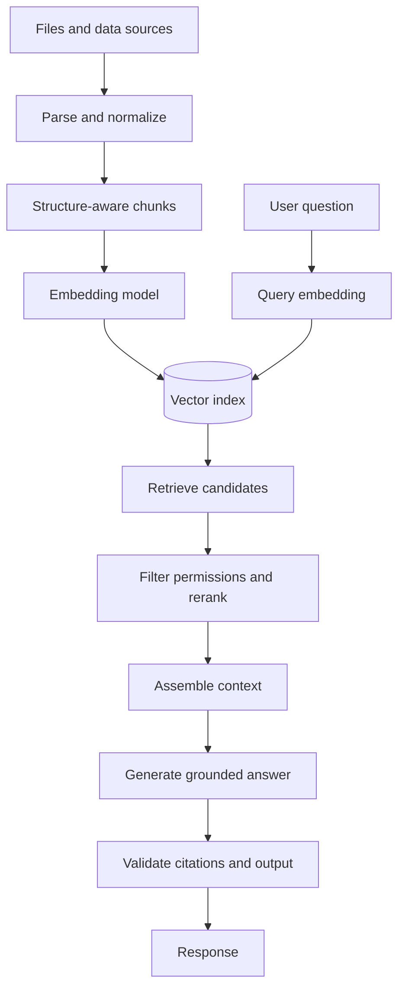

Retrieval-augmented generation (RAG) is often described as *"search your documents, then ask an LLM."* That's directionally correct, but it hides most of the engineering.

The interesting work happens before and after the model call: turning messy files into useful chunks, retrieving the right evidence, controlling context size, and checking whether the final answer is actually supported by that evidence.

Let's walk through the complete pipeline, from ingestion to a response a user can trust.


> [!TIP] The central idea
> The model's parametric knowledge is not your private knowledge base. RAG gives the model relevant external context at request time instead of expecting it to memorise every document.

## 1. Ingestion: make files usable before making them searchable

Imagine a support assistant that needs to answer questions from product documentation, incident reports, PDFs, and internal notes.

The first step is not embedding. It is **extraction and normalization**.

Typical inputs need different parsers:

| Input | Extraction strategy | Common problem |
| --- | --- | --- |
| Markdown | Parse headings, lists and links | Lost hierarchy |
| PDF | Text extraction plus layout analysis | Tables and columns get scrambled |
| HTML | Remove navigation and boilerplate | Repeated irrelevant text |
| DOCX | Extract paragraphs and tables | Formatting carries meaning |
| Images | OCR or a vision model | Text and layout can be missed |

I would preserve useful metadata from the beginning: source ID, title, URL or file path, page number, section heading, permissions, and last-updated time.

```ts
type SourceDocument = {
  id: string;
  title: string;
  content: string;
  mimeType: string;
  sourceUri: string;
  updatedAt: string;
  accessGroup?: string[];
};
```

Why keep this metadata? Because a useful answer should be able to point back to the original source, and retrieval must never leak a document the current user is not allowed to read.

## 2. Chunking: split by meaning, not just character count

Embedding an entire 80-page manual as one vector gives you a very blunt search result. Splitting every 500 characters without regard to structure is not much better: a heading can become detached from the paragraph it explains.

A practical starting strategy is **structure-aware chunking**:

1. Split on document sections and headings.
2. Keep paragraphs, list items, and table rows together where possible.
3. Apply a maximum token budget to each chunk.
4. Add a small overlap only when a concept crosses boundaries.
5. Store the heading path and source location with every chunk.

For example, a chunk might carry this metadata:

```json
{
  "documentId": "deployment-guide",
  "section": ["Operations", "Rollback procedure"],
  "page": 18,
  "chunkIndex": 12
}
```

The overlap is not a magic constant. Too little can cut a thought in half; too much creates duplicate search results and wastes context. Measure it against real questions from your users.

## 3. Embeddings: turn meaning into vectors

An embedding model maps text into a list of numbers. Text with related meaning tends to land near each other in the model's vector space.

For a simplified example, imagine these queries:

- "How do I restore a previous deployment?"
- "What's the rollback process?"
- "How can I undo a release?"

They use different words, but a good embedding model can place them close enough that the same documentation chunks become candidates.


The important detail: **query and document embeddings must be compatible**. Use the same embedding model and the correct task mode or prefixes expected by that model. If you change embedding models, plan to re-embed the corpus.

## 4. Indexing and retrieval: find candidates quickly

Store each chunk's vector alongside its text and metadata. A vector index can then find approximate nearest neighbours without comparing the query against every single vector.

At query time, the flow usually looks like this:

```text
User question
     |
     v
Query embedding
     |
     v
Vector similarity search  ---->  Top K candidate chunks
     |
     v
Metadata + permission filters
     |
     v
Candidate set
```

Cosine similarity is a common distance measure when vectors are normalized, though the right metric depends on the embedding model and index configuration.

```ts
const candidates = await vectorStore.search({
  vector: queryEmbedding,
  limit: 20,
  filter: {
    workspaceId: currentWorkspace.id,
    accessGroup: { in: currentUser.groups },
  },
});
```

The permission filter is not an optional optimization. It is a security boundary. Enforce access at retrieval time, not just in the prompt.

## 5. Reranking: improve the order before spending context

Vector search is good at finding semantically related candidates. It is not guaranteed to put the most useful passage first.

A reranker evaluates the query and each candidate together, then scores how relevant each passage is to that specific question. This can improve precision, especially when many chunks share similar vocabulary.

| Stage | Example count | Purpose |
| --- | ---: | --- |
| Vector retrieval | 20 | High-recall candidate search |
| Reranking | 20 → 5 | Improve relevance order |
| Context assembly | 5 → 3 | Fit the model's token budget |

These are illustrative numbers, not universal defaults. Evaluate recall and answer quality on your own query set before tuning `K`.

## 6. Context assembly: give the model evidence, not a document dump

Now we have a handful of relevant passages. We still need to build a clean prompt.

I like to include:

- The user's original question.
- The retrieved passages with stable source labels.
- A clear instruction to distinguish evidence from inference.
- A rule to say when the supplied context is insufficient.
- A citation format that maps back to source IDs and page or section locations.

```text
SYSTEM
Answer using the supplied sources. Do not invent details.
If the sources do not contain the answer, say what is missing.
Cite claims with the provided source labels.

QUESTION
How do I roll back a failed deployment?

SOURCES
[S1] Deployment guide, section 4.2: ...
[S2] Incident playbook, page 18: ...
```

Notice that the model is not asked to reveal its hidden reasoning. It is asked to produce a useful answer with verifiable support.

## 7. Generation: answer with boundaries

The LLM receives the question and the selected context. It generates a response, but generation is only one stage in the system.

The application should validate the output shape, preserve citations, apply safety and access rules, and handle provider timeouts. For important workflows, you may also run a lightweight citation or claim-support check before returning the answer.

The model call is only one part of the system. Retrieval quality, permission checks, and output validation matter just as much as generation.

## 8. What breaks in production?

The happy path is easy to draw. Real systems fail in less glamorous ways.

| Symptom | Likely cause | What I would inspect |
| --- | --- | --- |
| Relevant answer never appears | Bad extraction or chunk boundaries | Raw parsed text and chunk previews |
| Similar but wrong passage wins | Retrieval or reranking quality | Recall@K and reranker scores |
| Answer invents specifics | Weak evidence or prompt boundaries | Citation support and abstention rate |
| Private content appears | Missing authorization filter | Tenant and user-level retrieval tests |
| Answers become stale | Index not refreshed | Source version and ingestion lag |
| Latency suddenly rises | Slow embedding, search or reranking | Per-stage traces and percentiles |

I would instrument every stage separately. One total request duration cannot tell you whether the embedding provider, vector database, reranker, or LLM is responsible for a regression.

## 9. A small evaluation set beats prompt guessing

Before changing chunk sizes or switching embedding models, build a small dataset of realistic questions. For each question, record the source passages that should be retrieved and what a correct answer must contain.

Track at least:

- **Recall@K:** did retrieval include the relevant source?
- **MRR or nDCG:** were useful results ranked near the top?
- **Groundedness:** are answer claims supported by retrieved evidence?
- **Citation correctness:** do links and source locations point to the right material?
- **Latency and cost:** what does each stage add?

This turns RAG tuning from "the answer feels better" into an engineering process you can repeat.

## The complete picture



## Final takeaway

RAG is not "put vectors in a database and call an LLM." It is a data pipeline, a search system, a permissions boundary, and an evaluation problem wrapped around a generation step.

If I were building a first version, I would keep it boring: reliable extraction, structure-aware chunks, a compatible embedding model, metadata filters, a measured retrieval baseline, and citations. Add reranking and more complex query strategies only when evaluation shows where the baseline falls short.

That is how you get from a convincing demo to a system people can actually depend on.
